## Concept Project

# Movie Quiz

* Movie Quiz is an educational website built with HTML, CSS and JavaScript. Users answer five randomly selected movie questions, receive feedback on their answers and save their scores in their browser.

* I developed this project to practise JavaScript, including responding to user actions, loading JSON data, updating page content and using local storage.

* I planned the movie quiz through a mind map, sketches and wireframes for desktop and mobile layouts.

- The projects are as follows:

## Brainstorm 
* Design mind map for the functions:

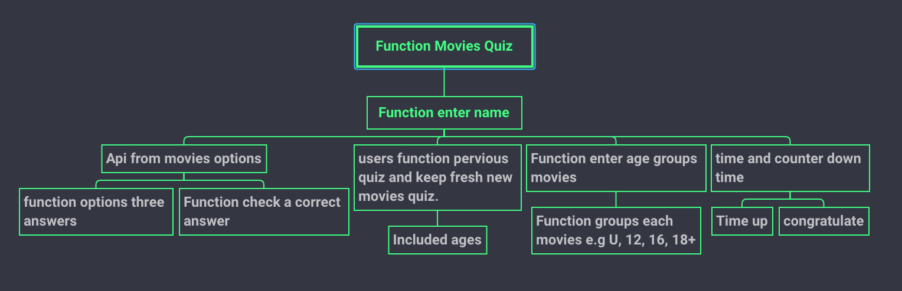

 # Quick Sketch UX
 * ## Desktop & Mobile

# Wireframe 
* # Design wireframe UX for Desktop & Mobile

* ## Desktop
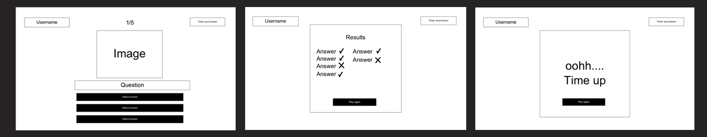

* ## Mobile
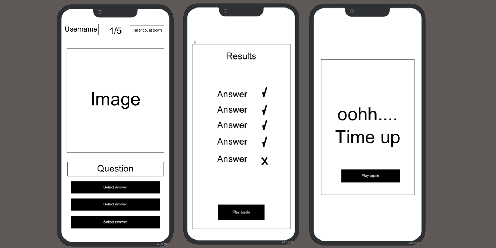

## Colour Palette

* I chose the colour palette that caught my eye. I searched for a website, found one, and chose the [colour palette](https://www.letseatcake.com/color-palettes-from-films/), and I took a screenshot, as seen attached here:

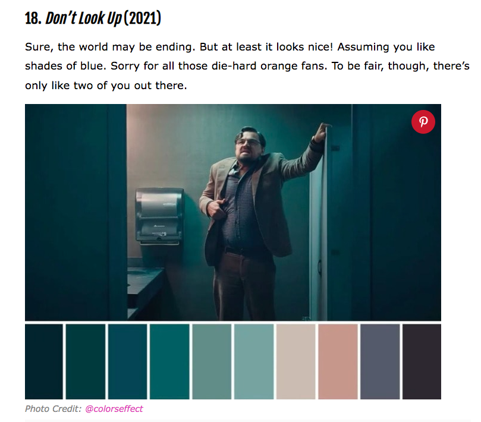

* ## I chose some of the colours; see picture below:
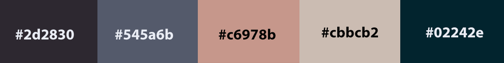

-------------------------------------------------------------------------------------------------------
# Design and development of the movie quiz for desktop & mobile devices

## Logo: Movies Quiz

Features
-------------
* The site is a Movie Quiz. It targets users interested in movies who want to challenge their knowledge by following directors, actors, writers, editors, and more.

Existing Features
-----------------------
### Navigation Bar

* The header menu has three pages: Home, Movie Quiz and Contact.

### Home page
* Display on the front image layout page
* The image below the button to enter play or high scores, or it is on top of the menu 'Movie Quiz '.

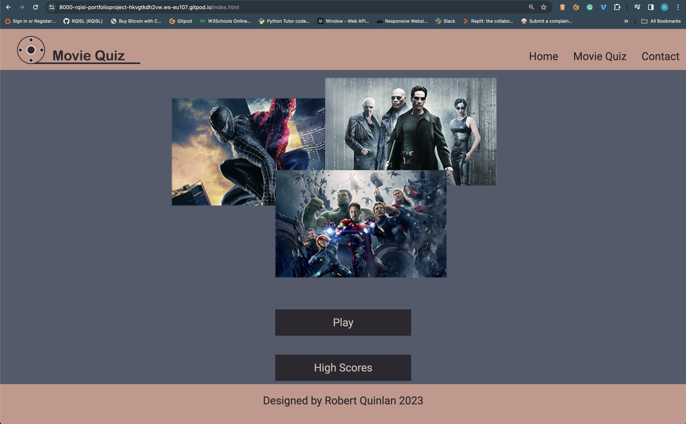

### Select the answer to the question on the movie quiz page

* To roll up the demand for the screen
* When you click on an answer, the next up to 5 questions will auto-advance to the next question
* When you click on the answer, it will display a red or green highlight indicating whether the answer is right or wrong. At the end of the quiz, it pops up a screen to ask the user to enter a username for the high score; there are three buttons: "Save", "Play again", and "Go Home". See three pictures

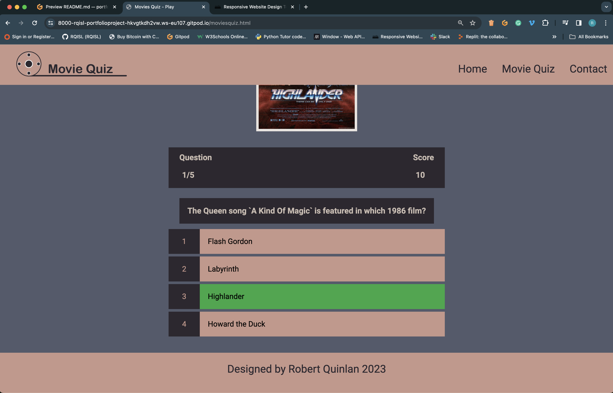 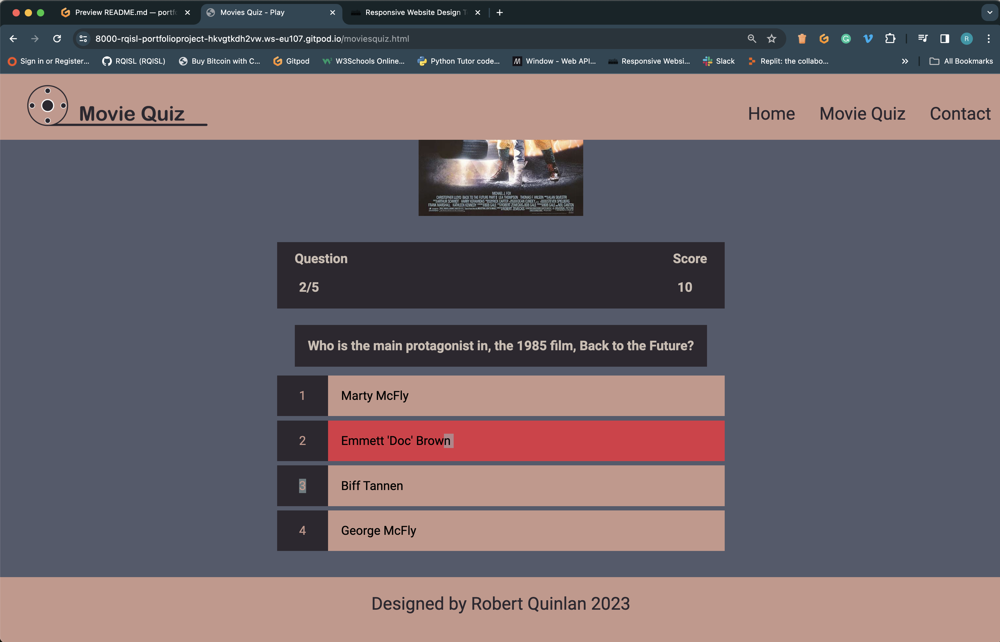 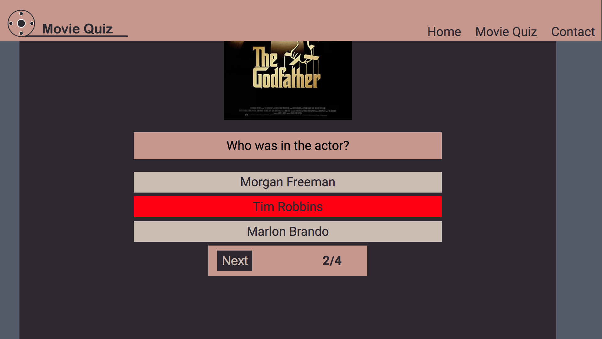 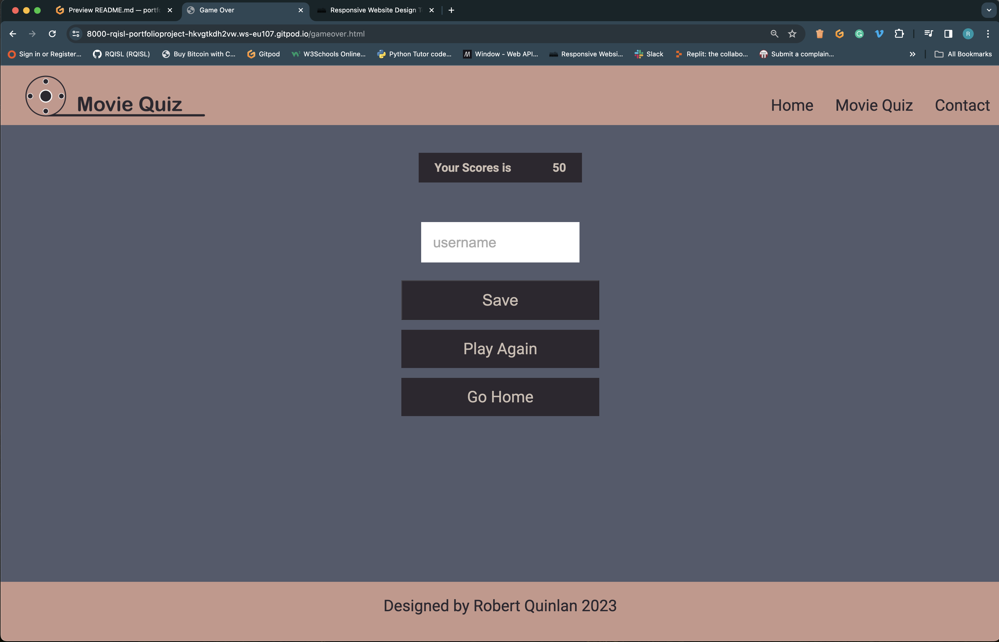

### Display High Score username list page

* After completing the quiz, users can enter a name and save their score.
* The high-score page displays the top five saved scores.
* Scores are saved in the same browser using localStorage. They are not shared between devices. Clearing the browser’s site data removes them.

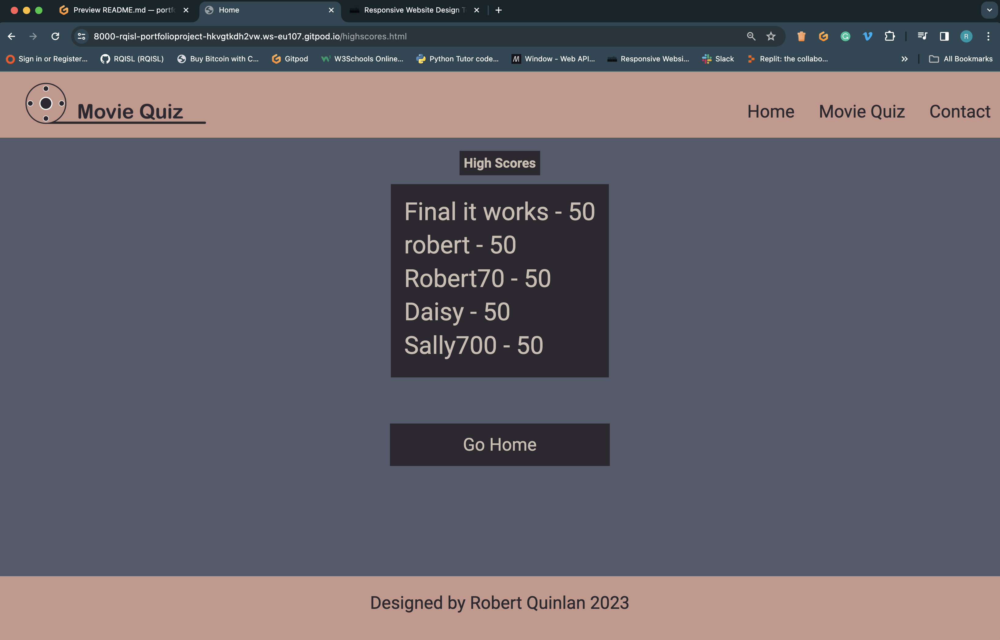

### Contact page

* Send a request to users who wish to have any comments.  See the picture, which is a responsive screen, as shown below:

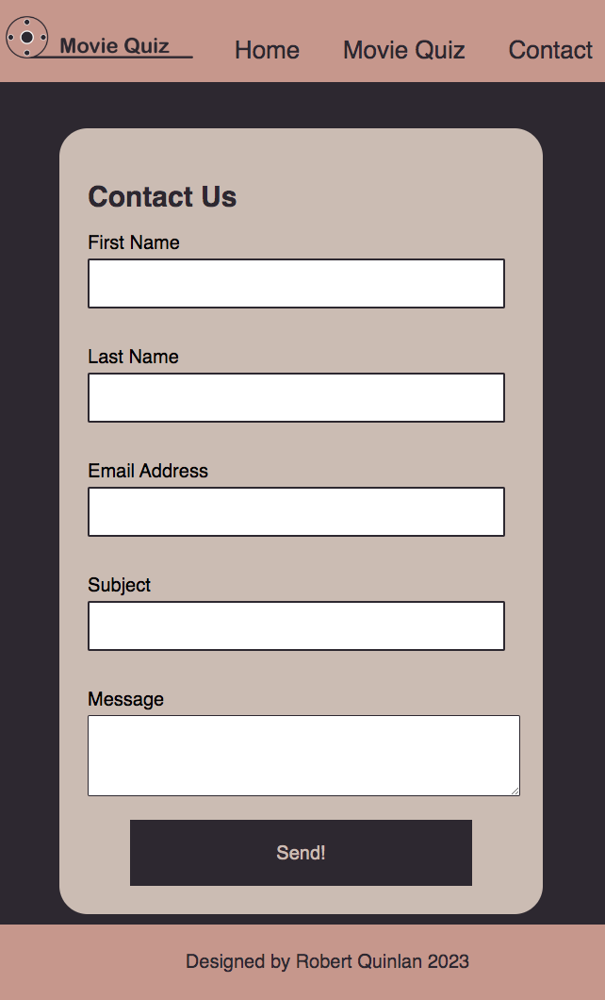

### Footer 
* Keep a simple display, as the website is designed by me.

### Testing
* The testing runs for Chrome, Opera, Microsoft Edge and Firefox, and it supports them. All the screens are fine and responsive, but they look slightly different on screens with different aspect ratios. 

### The Lighthouse runs testing and results.
* There was quite low performance in Lighthouse. I added alt text to each image and meta keywords. It improved the results, as seen in the picture below:
* ## Home page
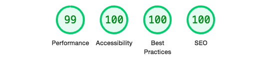

* ## Movie Quiz page
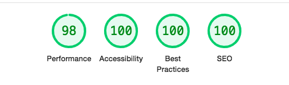

* ## Contact page

## Validation testing

### HTML
* A few errors were found when the test was run through the official W3C validator.
- There was an error: the tag `<h3>` was not used; it was replaced with ` 
`. I fixed the bug, and it passed with no errors.

### CSS
- The official (Jigsaw) validator. It passed with no errors.

### JavaScript
* The test ran at [Javascript testing](https://jshint.com/)  and there were 24 warnings. I fixed the bugs and reduced the warnings; there were no errors.

# Deployment

The GitHub page where it is deployed. How to access the deployed site is as follows:

* Use the files on the GitHub page and choose one of the files where it is in the “portfolio-project-1-robert-quinlan” file
* Click on setting 
* On the left side, follow the list of options
* To click on ‘page’
* The source under the option “Deploy from a Branch”
* The Branch under " Deploy from a Branch " is set to main and root; then click Save. 
* It ran the deployment process successfully.

The site lives at [Movie Quiz](https://rqisl.github.io/portfolio-project-2-robert-quinlan/)

## Credits

JavaScript was challenging for me during this project. I used course materials, tutorials and mentor feedback to improve my understanding of question handling, answer feedback and score storage.
Some planned features, including age groups and a countdown timer, were not implemented. The resources I used are credited below.

My mentor gave good feedback and helped me improve my process on the site project. 

## Resouce & tutorial
* ### I learned as many resources as possible I could learn.

1) [Ridpidapi video for API to get images of the poster](https://www.youtube.com/watch?v=ytNyibPQFhw) 
1) [Pick one of the images: how to use](https://makersaid.com/array-of-images-in-javascript/)
1) [Hidden Click](https://www.w3schools.com/css/tryit.asp?filename=trycss_display) 
1) How can I structure the quiz concept?
    - [Example quiz 1](https://simplestepscode.com/javascript-quiz-tutorial/)
    - [Example quiz 2](https://www.youtube.com/watch?v=f4fB9Xg2JEY) 
1) [Output result](https://codepen.io/yaphi1/pen/NpZvJp)
1) [How can  I do the question on the next slide](https://www.youtube.com/watch?v=uAAD3mmQGRQ)
1) [Array through to Code Institute resource](https://learn.codeinstitute.net/courses/course-v1:CodeInstitute+LMR101+2021_T1/courseware/0a4bf408d10c4149bb686457ac11edf6/9ad9ed6044aa49c0ae12507f3c03aa79/)
1) [Enter username on the screen through Code Institute](https://learn.codeinstitute.net/courses/course-v1:CodeInstitute+LMR101+2021_T1/courseware/0a4bf408d10c4149bb686457ac11edf6/16d62f1111064f5cb6a64582da96a41b/?child=last.)
    - [Example 1](https://youtu.be/Iw6fyph6MNw)
    - [Example 2](https://youtu.be/KB6Yg5hNrqc)
    - [Example 3](https://www.youtube.com/watch?v=aEj0Wu33hJM) 
1) Click highlight
    - [Example 1](https://learn.codeinstitute.net/courses/course-v1:CodeInstitute+LMR101+2021_T1/courseware/0a4bf408d10c4149bb686457ac11edf6/fe180c06af614d2f86e32957ae17a859/?child=last) 
    - [Example 2](https://learn.codeinstitute.net/courses/course-v1:CodeInstitute+LMR101+2021_T1/courseware/0a4bf408d10c4149bb686457ac11edf6/fe180c06af614d2f86e32957ae17a859/?child=last)
    - [Example 3](https://stackoverflow.com/questions/39852228/style-backgroundcolor-doesnt-work)
1) Click highlight remove and active 
    - [Example 1](https://learn.codeinstitute.net/courses/course-v1:CodeInstitute+LMR101+2021_T1/courseware/0a4bf408d10c4149bb686457ac11edf6/37e3becd93804fdf8bf586523f56ead5/5?activate_block_id=block-v1%3ACodeInstitute%2BLMR101%2B2021_T1%2Btype%40html%2Bblock%404b2504c0ab4e40d6b42d4b527776707a)
    - [Example 2](https://softauthor.com/make-selected-clicked-button-active-in-javascript/)
1) [Output HTML in JavaScript](https://learn.codeinstitute.net/courses/course-v1:CodeInstitute+LMR101+2021_T1/courseware/0a4bf408d10c4149bb686457ac11edf6/37e3becd93804fdf8bf586523f56ead5/) 
1) [Overlay 3 W School](https://www.w3schools.com/howto/howto_css_overlay.asp)
1) For loop
    - [Example 1](https://www.w3schools.com/jsref/tryit.asp?filename=tryjsref_onclick)
    - [Example 2](https://www.w3schools.com/jsref/tryit.asp?filename=tryjsref_foreach)
    - [Example 3](https://www.freecodecamp.org/news/javascript-foreach-js-array-for-each-example/amp/)
    - [Example 3](https://www.freecodecamp.org/news/javascript-foreach-js-array-for-each-example/amp/)

## Adobe Photoshop & Illustrate

* The logo images I created in Photoshop. I downloaded the image from [www.vecteezy.com](https://www.vecteezy.com/vector-art/19115573-creative-business-card-and-logo-template-album-film-movie-reel-vector-illustration) under a free license. I chose a roll movie image and edited it in Adobe Illustrator to create a logo. 
* The movie poster layout on the front page comes from [https://www.wallpaperflare.com](https://www.wallpaperflare.com/). It is free to download for those who wish to use the wallpaper on their desktop, laptop, tablet or mobile.
* I downloaded three movie posters:
    - [Matrix](https://www.wallpaperflare.com/the-matrix-poster-movies-neo-keanu-reeves-morpheus-carrie-anne-moss-wallpaper-mjcss/download/1920x1200)
    - [Avengers](https://www.wallpaperflare.com/marvel-avengers-the-avengers-avengers-age-of-ultron-thor-wallpaper-zkw/download/1920x1200)
    - [Spiderman](https://www.wallpaperflare.com/spider-man-movies-spider-man-3-marvel-comics-black-suited-spiderman-wallpaper-pnkas/download/1920x1200)
* I made an overlapping layout of the movie posters where I used Adobe Photoshop 

## Concluded 

## What I Learned

* This project helped me practise loading questions from JSON, handling click events, updating page content, calculating scores and saving data in localStorage. I also gained experience translating wireframes into a website and investigating coding problems.
View the live project: [Movie Quiz](https://rqisl.github.io/portfolio-project-2-robert-quinlan/).
